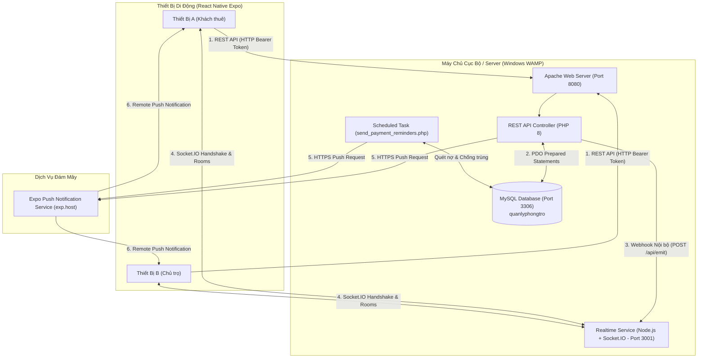

# BÁO CÁO KỸ THUẬT HỆ THỐNG QUẢN LÝ NHÀ TRỌ (MOBILE & REALTIME)

## 1. Mục tiêu đề tài

Xây dựng và hoàn thiện giải pháp chuyển đổi số toàn diện cho mô hình quản lý nhà trọ / phòng trọ, bao gồm:
- **Ứng dụng di động (Mobile App)** phát triển bằng React Native & Expo Router, hỗ trợ 2 phân hệ vai trò: **Khách thuê phòng** và **Chủ trọ / Quản trị viên**.
- **Hệ thống Backend REST API** phát triển trên nền tảng PHP 8 và cơ sở dữ liệu quan hệ MySQL chạy trên máy chủ cục bộ WampServer.
- **Hệ thống Realtime** độc lập ứng dụng Node.js & Socket.IO phục vụ việc phản hồi và tương tác hai chiều tức thời (Realtime Events).
- **Hệ thống Thông báo đa kênh (Push Notification & In-app History)** qua dịch vụ Expo Push Service, tự động hóa quy trình phát hành hóa đơn, quét nhắc hạn đóng tiền và theo dõi tiến độ giải quyết sự cố.

---

## 2. Kiến trúc tổng thể hệ thống

Hệ thống được thiết kế theo mô hình kiến trúc phân lớp (Layered Architecture) và kiến trúc hướng sự kiện (Event-Driven Architecture) đảm bảo tính mở rộng và phân tách trách nhiệm rõ ràng:

---

## 3. Danh sách REST API

Mọi hoạt động nghiệp vụ đều được chuẩn hóa qua giao thức RESTful API với định dạng JSON:

| Phương thức | Đường dẫn Route | Quyền truy cập | Mô tả nghiệp vụ |
| :--- | :--- | :--- | :--- |
| `GET` | `/api/health` | Public | Kiểm tra trạng thái hoạt động của API và MySQL |
| `GET` | `/api/demo-tenants` | Public | Lấy danh sách khách thuê mẫu cho thử nghiệm 1 chạm |
| `POST` | `/api/login` | Public | Đăng nhập tài khoản (hỗ trợ cả Admin và Khách thuê) |
| `POST` | `/api/register` | Public | Đăng ký tài khoản khách thuê mới và liên kết hồ sơ |
| `GET` | `/api/dashboard` | Token (Tất cả) | Trả về dữ liệu bảng điều khiển tương ứng theo vai trò |
| `GET` | `/api/rooms` | Token (Tất cả) | Danh sách phòng (Chủ trọ xem tất cả; Khách thuê xem phòng mình) |
| `GET` | `/api/invoices` | Token (Tất cả) | Danh sách hóa đơn và mã thanh toán VietQR |
| `POST` | `/api/invoices` | Token (Admin) | Tạo và phát hành hóa đơn mới -> Gửi Push Notification |
| `POST` | `/api/payments` | Token (Admin) | Ghi nhận thanh toán hóa đơn tiền phòng |
| `GET` | `/api/maintenance` | Token (Tất cả) | Danh sách yêu cầu sửa chữa |
| `POST` | `/api/maintenance` | Token (Khách thuê)| Báo sự cố mới -> Gửi Push & phát Socket.IO `incident:created` |
| `POST` | `/api/maintenance/update`| Token (Admin) | Cập nhật tiến độ -> Gửi Push & phát Socket.IO `incident:status:changed` |
| `POST` | `/api/push-token` | Token (Tất cả) | Đăng ký / cập nhật Expo Push Token của thiết bị |
| `POST` | `/api/push-token/remove`| Public / Token | Hủy đăng ký push token khi đăng xuất |
| `GET` | `/api/notifications` | Token (Tất cả) | Xem danh sách thông báo và số lượng chưa đọc |
| `POST` | `/api/notifications/read/{id}` | Token (Tất cả) | Đánh dấu 1 thông báo là đã đọc |
| `POST` | `/api/notifications/read-all` | Token (Tất cả) | Đánh dấu tất cả thông báo là đã đọc |
| `POST` | `/api/reminders/run` | Token (Admin) | Kích hoạt tác vụ quét và gửi nhắc hạn đóng tiền tự động |

---

## 4. Cơ chế xác thực và phân quyền (Authentication & Authorization)

### 4.1. Cơ chế băm mật khẩu
- Mật khẩu người dùng được băm an toàn ở tầng backend thông qua hàm `password_hash($password, PASSWORD_DEFAULT)` (chuẩn Bcrypt).
- Cơ chế kiểm tra mật khẩu sử dụng `password_verify()`. Tự động nâng cấp các tài khoản mật khẩu văn bản thuần sang hash Bcrypt ngay khi đăng nhập thành công.

### 4.2. Cơ chế cấp Token xác thực
- Sau khi xác thực danh tính thành công, server sinh Bearer Token theo định dạng ký HMAC-SHA256:
  $$\text{Payload} = \text{userId} \cdot \text{role} \cdot \text{expiresAt}$$
  $$\text{Token} = \text{base64url}(\text{Payload}) \mathbin{\Vert} \text{HMAC-SHA256}(\text{Payload}, \text{Secret})$$
- Thời hạn hiệu lực: 7 ngày (`time() + 86400 * 7`).
- Phân biệt vai trò `role` được bảo vệ bằng chữ ký mật mã, ngăn chặn triệt để client giả mạo quyền `admin`.

---

## 5. Quy trình Push Notification

### 5.1. Đăng ký Push Token
1. Khi đăng nhập vào ứng dụng mobile, hàm `registerForPushNotificationsAsync()` kiểm tra quyền thông báo trên thiết bị.
2. Thiết bị gọi Expo Push Service để nhận `ExponentPushToken[...]`.
3. Client gửi token lên API `POST /api/push-token`.
4. Backend lưu token vào bảng `push_tokens` với ràng buộc `ON DUPLICATE KEY UPDATE`, hỗ trợ nhiều thiết bị trên một tài khoản.

### 5.2. Nghiệp vụ 1: Thông báo hóa đơn tháng mới
- Khi Admin tạo hóa đơn mới:
  1. Backend lưu bản ghi vào bảng `invoices` và `invoice_details`.
  2. Xác định `tenant_id` và lấy `user_id` liên kết.
  3. Tạo bản ghi trong bảng `notifications` (`reference_type='invoice'`).
  4. Gửi Remote Push Notification đến thiết bị của khách thuê qua Expo Push API.
  5. Payload chứa `reference_id` và `type='new_invoice'`. Khi nhấn vào notification, ứng dụng tự động mở hóa đơn.

### 5.3. Nghiệp vụ 2: Nhắc hạn đóng tiền tự động (Server-side & Chống gửi trùng)
- Kịch bản chạy nền định kỳ: `scripts/send_payment_reminders.php`.
- Điều kiện quét: Các hóa đơn có `remaining_amount > 0`, trạng thái `unpaid` / `partially_paid` / `overdue` và hạn nộp `due_date <= DATE_ADD(CURDATE(), INTERVAL 1 DAY)`.
- **Cơ chế chống gửi trùng (Idempotency):**
  - Bảng `payment_reminder_logs` có ràng buộc khóa duy nhất `UNIQUE KEY (invoice_id, reminder_type, reminder_date)`.
  - Nếu hóa đơn đã được nhắc trong ngày hiện tại, câu lệnh INSERT sẽ bị chặn lại hoặc mệnh đề `NOT EXISTS` sẽ loại bỏ hóa đơn khỏi danh sách gửi.

### 5.4. Nghiệp vụ 3: Báo sự cố và cập nhật tiến độ
- **Khi khách thuê gửi sự cố:**
  - Lưu vào `maintenance_requests` với trạng thái `pending`.
  - Gửi push notification đến tất cả thiết bị của Admin: `"Sự cố mới cần tiếp nhận"`.
- **Khi Admin đổi trạng thái:**
  - Lưu trạng thái mới (`pending` → `in_progress` → `completed` / `rejected`), ghi chú và chi phí.
  - Gửi push notification riêng cho người thuê báo sự cố: `"Cập nhật sự cố: [Tiêu đề]"`.

---

## 6. Kiến trúc Realtime Socket.IO

### 6.1. Thiết kế dịch vụ
- Dịch vụ Node.js độc lập chạy tại cổng `3001` (`realtime-server/`).
- Bắt buộc xác thực handshake: Client gửi `auth: { token }`. Middleware `authMiddleware` giải mã và kiểm tra chữ ký HMAC-SHA256 với khóa bí mật dùng chung. Nếu không hợp lệ hoặc hết hạn, kết nối bị từ chối ngay lập tức.

### 6.2. Phân quyền Room
- Khi kết nối thành công:
  - Mọi người dùng tự động tham gia room cá nhân: `user_${userId}`.
  - Quản trị viên tham gia room: `admin`.
  - Khách thuê tham gia room: `tenant`.
- Máy chủ kiểm tra quyền nghiêm ngặt, ngăn chặn khách thuê tự ý gia nhập room của người khác.

### 6.3. Tích hợp PHP Webhook sang Socket.IO
- Do backend chính là PHP WAMP, PHP giao tiếp với Node.js qua HTTP Webhook nội bộ:
  $$\text{POST } \text{http://127.0.0.1:3001/api/emit}$$
  Header xác thực: `x-realtime-secret: QLPT-REALTIME-SECRET-2026`.
- Sau khi PHP hoàn tất transaction MySQL:
  - Sự cố mới: Phát sự kiện `incident:created` tới room `admin`.
  - Cập nhật sự cố: Phát sự kiện `incident:status:changed` tới room `user_${tenantUserId}` và `admin`.

---

## 7. Giới hạn kỹ thuật và giải pháp tương thích

1. **Expo Go trên Android từ SDK 53 trở lên:**
   - Expo Go trên Android không còn hỗ trợ nhận Remote Push Notification thông qua FCM mặc định mà yêu cầu tạo Development Build (`npx expo run:android`).
   - *Giải pháp đã tích hợp:* Ứng dụng tích hợp đồng thời cơ chế **Socket.IO Realtime In-app Banner**, **Lịch sử thông báo cơ sở dữ liệu** và tính năng **Lên lịch thông báo cục bộ (Local Notifications)** để đảm bảo người dùng và hội đồng thẩm định luôn quan sát được thông báo kể cả trên Expo Go.
